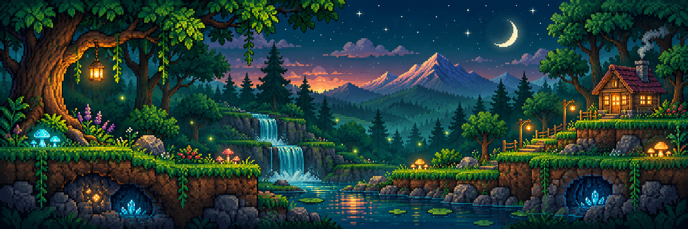

<div align="center">



# 🌲 KaelLee335's Forest Workshop

### Digging into data · Building with code · Always exploring

<a href="mailto:lzi835339@gmail.com"></a>
<a href="https://github.com/KaelLee335"></a>

</div>

## 🪵 Base Camp

```text
🌱 Currently growing   Python · SQL · Data tools
⛏️  Exploring          Automation · Quant research · Open source
🏕️  Environment        Windows · WSL2 · VS Code · Codex
✨ Side quest          Turning ideas into useful little systems
📫 Camp mailbox       lzi835339@gmail.com
```

## 🎒 Inventory

<p align="center">
  
</p>

## 📜 Adventure Log

<div align="center">
  
  
</div>

<div align="center">
  
</div>

## 🗺️ Recent Expeditions

<div align="center">
  
</div>

---

<div align="center">
  <sub>🌙 Thanks for visiting. The forest changes whenever new code is planted.</sub>
</div>
